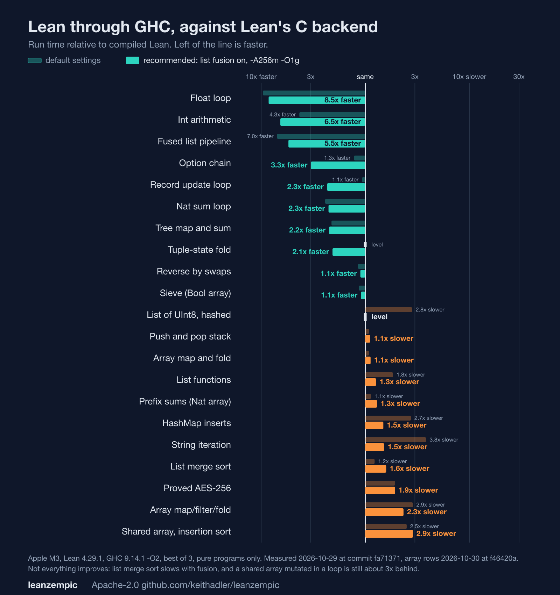

# leanzempic 🙂

A Haskell backend for Lean 4. It takes the terms Lean's compiler produces and prints them as Haskell
shaped like GHC Core, so that GHC's optimizer (strictness analysis, worker/wrapper, join points,
list fusion, unboxing) decides how your Lean program runs, instead of Lean's C backend.

* License: Apache-2.0, public
* Status: pre-release (`v0.1.0-rc1` is the first tag), single maintainer
* Tested on: macOS arm64 (Apple M3, and macOS 15 in CI) and Linux x86_64 (Ubuntu, in CI); Lean 4.29.1
  and GHC 9.14.1 only. CI runs the test suite on both, with a 36-program subset of the garden.
* Honest one-line summary: up to 9x faster than Lean's C backend on numeric, `Int`, `Float`, record and
  fused-list code; with the recommended settings, between level and 3x slower on lists, tuples,
  strings and hash maps (up to 4x slower with defaults); 4x to 18x slower on arrays, which is the main
  open problem. See [Benchmarks](#benchmarks) for every number, including the losses.



**To get the speed:** put `set_option zempic.fuse true` before the definitions you compile, and run
the Haskell with `-A256m -O1g` (`tools/zghc` does). Both are explained below, with their costs.

## Contents

1. [Why this exists](#why-this-exists)
2. [Quick start](#quick-start)
3. [How it works](#how-it-works)
4. [The `#zempic` command and its modes](#the-zempic-command-and-its-modes)
5. [Exact `Nat` at word speed (auto mode)](#exact-nat-at-word-speed-auto-mode)
6. [How Lean types map to Haskell](#how-lean-types-map-to-haskell)
7. [List fusion](#list-fusion)
8. [Arrays and the ownership analysis](#arrays-and-the-ownership-analysis)
9. [Strings](#strings)
10. [Structures, enums, trees and generic data](#structures-enums-trees-and-generic-data)
11. [Where behavior differs from Lean](#where-behavior-differs-from-lean)
12. [What is supported and what is not](#what-is-supported-and-what-is-not)
13. [Benchmarks](#benchmarks)
14. [Production readiness](#production-readiness)
15. [Testing](#testing)
16. [What is proved](#what-is-proved)
17. [Repository layout](#repository-layout)
18. [Developing](#developing)
19. [Troubleshooting](#troubleshooting)
20. [Things that did not work](#things-that-did-not-work)
21. [Roadmap](#roadmap)
22. [Lean Studio and the linter](#lean-studio-and-the-linter)
23. [Support](#support)

---

## Why this exists

Lean's C backend is slow next to OCaml and Haskell on many programs. Two reasons matter:

* **Reference counting.** Every heap value carries a count that is updated on every copy and drop.
  Lean recovers some speed by updating a value in place when its count is one.
* **No fusion.** A chain such as `range |> map |> filter |> foldl` builds and discards a list at
  every stage. Lean specializes each stage into its own loop, but the intermediate lists remain.

GHC has no reference counts and has had foldr/build fusion, strictness analysis and worker/wrapper
unboxing for decades. leanzempic's job is to hand GHC a Lean program in a form it can use: strict
where Lean is strict, with Lean's evaluation order, join points and data layout intact.

The honest result so far is that this wins big where GHC's analyses apply (tight numeric loops,
record-carrying loops, fusible pipelines) and loses where Lean's reference counts were doing real
work for it (in-place arrays at scale). Both halves are measured below.

## Quick start

### Prerequisites

| Tool | Version tested | Notes |
|---|---|---|
| elan + Lean | 4.29.1 (pinned in `lean-toolchain`) | The compiler API it uses (LCNF) changes between versions |
| GHC | 9.14.1 | Needs `base`, `text`, `bytestring`, `array` (all ship with GHC) |
| Cabal | any recent | Only for the optional [Core plugin spike](plugin/README.md) |
| Python 3 | 3.9+ | Only to regenerate part of the runtime (`tools/gen_runtime.py`) |

`#zempic` checks the Lean version and refuses anything but 4.29.x with a clear message
(`set_option zempic.allowOtherLean true` tries anyway, at your own risk), and rejects an unknown mode
instead of silently using `auto`.

One environment trap: **run GHC without Lean's toolchain `bin` directory on `PATH`.** Lean bundles
its own `clang`; if it shadows the system one, GHC's C step fails with
`'inttypes.h' file not found`. `tools/zghc` handles this for you.

### Compile a Lean function to Haskell

From the repository root, build the library once, then run any Lean file that imports it:

```sh
lake build Zempic
```

```lean
-- Hello.lean
import Zempic

def fact : Nat → Nat
  | 0 => 1
  | n + 1 => (n + 1) * fact n

#zempic fact to "build/Out.hs"
```

```sh
lake env lean Hello.lean
```

That writes `build/Out.hs`, `build/Out/Fast.hs`, `build/Out/Exact.hs` and `build/Out.core` (see
[modes](#the-zempic-command-and-its-modes)). The programs in `examples/` do the same thing and are
built with `lake build Examples`. Then call it from Haskell:

```haskell
-- Main.hs
import Numeric.Natural (Natural)
import Out

main :: IO ()
main = print (z_fact 25 :: Natural)   -- 15511210043330985984000000, exact
```

```sh
tools/zghc -ibuild Main.hs -o main && ./main
```

`tools/zghc` is GHC with the right flags (`-O2`, `-iruntime`, `-A256m -O1g`, which raises peak memory by about the allocation area; set `ZEMPIC_RTS="-A64m"` to use less) and with Lean's
toolchain taken off `PATH`, which avoids the clang trap below. Plain `ghc -O2 -iruntime -ibuild`
works too if Lean's `bin` is not on your `PATH`. To use the runtime as a package instead of
`-iruntime`, build `runtime/zempic-runtime.cabal` and pass `-package zempic-runtime`.

Generated function names are `z_` followed by the mangled Lean name (`fact` becomes `z_fact`).

### Run the tests

```sh
PATH=/opt/homebrew/bin:/usr/bin:/bin:$HOME/.elan/bin sh tests/run.sh
```

It builds every example, compiles the generated Haskell, and checks each result against native
Lean, then runs the garden, the AES check and the fuzzer. Each check prints `ok` (the plugin check only
if Cabal is installed); any failure aborts with `FAIL`. The whole garden takes about 15 CPU-minutes;
`GARDEN_SET=ci GARDEN_OPT=-O1 GARDEN_FUSE=1 sh tests/run.sh` runs the 36-program subset CI uses.

## How it works

```
Lean source
   |  Lean's own compiler (unchanged)
   v
LCNF, mono phase        erased types, A-normal form, explicit join points, strict order
   |  Zempic/Own.lean      ownership analysis: which array updates may be in place
   |  Zempic/Emit.lean     printers: LCNF -> Haskell, and LCNF -> Core-notation text
   v
Out.hs / Out/Fast.hs / Out/Exact.hs      plus the Haskell runtime in runtime/Zempic/
   |  GHC -O2
   v
native binary
```

### Why LCNF

LCNF (Lean's compiler IR, "mono" phase) is where Lean has already done the work a Haskell backend
needs: types are erased, every intermediate value is named (A-normal form), control flow has
explicit join points, and evaluation order is Lean's strict, left-to-right order. leanzempic reads
it with `Lean.Compiler.LCNF.getDeclAt? name .mono` and prints it, so it never has to re-derive
any of that.

### The translation

| LCNF | Emitted Haskell | Why |
|---|---|---|
| `let x := v` | `let !x = v in ...` (a strict binding, a `case` in Core) | Lean evaluates eagerly |
| `jp j x := body; k` | `let j x = body in k` | GHC turns saturated tail-called local functions into real join points |
| `jmp j args` | `j args` | |
| `cases x` | `case x of ...` on a generated `data` type, `Bool`, `[]` or a tuple | |
| `x.proj i` | a single-constructor `case` | |
| `fun f x := ...` | `let f = zo (\x -> ...)` | closures are `Any` |
| `return x` | `x` | |
| calls | saturated direct calls; partial and over-application go through `zap` | |

A real example. This Lean:

```lean
def fact : Nat → Nat
  | 0 => 1
  | n + 1 => (n + 1) * fact n
```

becomes (abridged from `build/Examples/Fast.hs`):

```haskell
z_fact :: ZNat -> ZNat
z_fact v0_x1 =
  let { !v1_zero = (0 :: ZNat) } in
  let { !v2_isZero = natEq v0_x1 v1_zero } in
  case (v2_isZero :: Bool) of {
    True ->
      let { !v3_x2 = (1 :: ZNat) } in
      v3_x2;
    False ->
      let { !v4_one = (1 :: ZNat) } in
      let { !v5_n3 = natSub v0_x1 v4_one } in
      let { !v6_x4 = natAdd v5_n3 v4_one } in
      let { !v7_x5 = z_fact v5_n3 } in
      let { !v8_x6 = natMul v6_x4 v7_x5 } in
      v8_x6 }
```

GHC then compiles this to a worker over unboxed `Word#` with no allocation in the loop.

### Names

Lean names become Haskell identifiers by a prefix code (`Zempic/Names.lean`):

* functions `z_...`, constructors `ZC_...`, types `ZT_...`
* letters and digits stay; `.` becomes `_`; `_` becomes `'u`; any other character becomes `'x` plus
  six hex digits plus `'`

So `foo._lam` is `z_foo_'ulam`, and no two Lean names can collide
([proved](#what-is-proved)).

### The two printers

* **Haskell** (`hsCode`, `hsDecl`): the real output.
* **Core notation** (`coreCode`, `coreDecl`): a readable `.core` dump in GHC-Core style
  (`case rhs of x { __DEFAULT -> ... }`, `join { j x = ... }`). GHC cannot read it back; it exists
  for inspection and for the [Core plugin spike](plugin/README.md).

## The `#zempic` command and its modes

```lean
#zempic f g h                                  -- print the generated Haskell in the infoview
#zempic f g h to "build/Out.hs"                -- write files (auto mode)
#zempic f g h to "build/Out.hs" mode word      -- one module, Nat as Word
#zempic f g h to "build/Out.hs" mode exact     -- one module, Nat as Natural
#zempic f g h to "build/Out.hs" mode core      -- stub + s-expressions for the Core plugin spike
```

`f g h` are the **roots**: everything they reach is compiled too. The module name is the file stem
(`Out`).

| Mode | Files written | Nat is | When to use |
|---|---|---|---|
| `auto` (default) | `Out.hs`, `Out/Fast.hs`, `Out/Exact.hs`, `Out.core` | `Word` first, exact `Natural` on overflow | almost always |
| `word` | `Out.hs`, `Out.core` | `Word`; overflow throws `ZOverflow` | programs known to stay below 2^64 |
| `exact` | `Out.hs`, `Out.core` | `Natural` | plain Lean semantics when speed does not matter |
| `core` | `Out.hs` (stub), `Out.zc` | `Word` | the Core plugin spike, `Nat`/`Bool` subset only |

Lean options (set with `set_option` at the top of a file):

| Option | Default | Effect |
|---|---|---|
| `zempic.fuse` | `false` | rewrite ordinary list code into fusible combinators ([below](#list-fusion)) |
| `zempic.own` | `true` | update arrays in place where the ownership analysis proves it safe |

If something in the reachable code is unsupported, `#zempic` fails with a list of every unsupported
constant and writes nothing. It never silently drops code.

## Exact `Nat` at word speed (auto mode)

Lean's `Nat` is unbounded. A faithful Haskell `Natural` is slow (out-of-line arithmetic on a boxed
sum type: 3x to 5x slower than Lean on loops). A plain 64-bit `Word` is fast but wrong when a number
overflows. Auto mode gets both:

1. The code is generated **twice**: `Out/Fast.hs` with `Nat = Word`, where any operation that would
   exceed 2^64 - 1 throws `ZOverflow`, and `Out/Exact.hs` with `Nat = Natural`.
2. `Out.hs` exports each root with ordinary `Natural` arguments and result. A call first runs the
   fast version under an exception handler. If it overflows, the same **pure** call is re-run on the
   exact version.

The result is always exact: `25!` and `3000!` both check against Python. The common case runs at
word speed. The cost is that a call which overflows late does its work twice.

Details worth knowing:

* Literals above 2^64 - 1 in fast code raise `ZOverflow` when used.
* The wrapper (`Zempic.Auto.tryFast`) exists only for roots whose arguments and result are all
  `Nat` or `Bool`. Roots with other types are left out of `Out.hs` (it says so in a comment); import
  them from `Out.Fast` or `Out.Exact` directly. Those two modules define separate `data` types, so
  structure-typed values cannot cross between them.
* Fixed-width integers (`UInt8` ... `UInt64`, `USize`) and `Char` never overflow: they wrap exactly
  as in Lean.

## How Lean types map to Haskell

| Lean | Haskell | Notes |
|---|---|---|
| `Nat` | `ZNat` = `Word` (Fast) or `Natural` (Exact) | |
| `Bool` | `Bool` | |
| `UInt8`, `UInt16`, `UInt32`, `UInt64` | `Word8`, `Word16`, `Word32`, `Word64` | wrapping, shifts masked to the width, `x / 0 = 0`, `x % 0 = x`, as in Lean |
| `USize` | `Word` | 64-bit only |
| `Char` | `Word32` | `Char.ofNat` applies Lean's scalar-value rule |
| `Int` | `Integer` | `/` and `%` are Euclidean as in Lean; `Int.tdiv`, `fdiv` and friends too; `cases` on `ofNat`/`negSucc` works |
| `Float` | `Double` | `Float.ofScientific` is correctly rounded, `toUInt*` saturates and sends NaN to 0 |
| `ByteArray` | the string buffer, bytes only | `push`, `get!`, `set!`, `size` |
| `Thunk α` | a lazy box | |
| a structure with one relevant field (`String.Pos`) | the field itself | Lean's own representation; declaring it as a constructor would be a type lie |
| `String` | shared UTF-8 buffer ([`Zempic.Str`](runtime/Zempic/Str.hs)), held as `Any` | byte sizes and ordering match Lean |
| `Array α` | Baker persistent array ([`Zempic.Arr`](runtime/Zempic/Arr.hs)), held as `Any` | elements are `Any` |
| `List α` | Haskell `[]`, elements `Any` | needed for fusion |
| `α × β` | Haskell tuple `(Any, Any)` | |
| user `structure` / `inductive` | generated `data ZT_...` with **strict, typed fields** | |
| generic inductive (`Option α`, `MProd α β`, your own) | polymorphic `data ZT_Name a0 a1` | one layout for every instantiation |
| functions | `Any` (called through `zap`) | |
| everything else | not supported | listed in the error |

`Any` is `GHC.Exts.Any`. Values move in and out of it with `zo` / `zu` (`unsafeCoerce`), which cost
nothing at run time. One thing to remember: **a cast between `Any` and a real type appears in the
Core as an opaque `case`, and it blocks GHC's list-fusion rewrite rules.** That is why `List` is a
native `[Any]` with no cast between fusion stages.

## List fusion

GHC fuses `map`, `filter`, `foldr`, `foldl'` and friends through `build`/`foldr` rules, so a pipeline
becomes one loop with no intermediate lists. From Lean you have two ways to use it.

**1. Write the pipeline with `Zempic.Fuse` explicitly:**

```lean
import Zempic

def pipe (n : Nat) : Nat :=
  Zempic.Fuse.foldl (· + ·) 0
    (Zempic.Fuse.filter (fun y => y % 3 != 0)
      (Zempic.Fuse.map (fun x => x * x % 1000) (Zempic.Fuse.range n)))
```

`Zempic.Fuse.*` are ordinary Lean functions (`@[noinline]` wrappers around `List.*`), so the program
still runs and proves in Lean. The Haskell backend replaces them by name.

**2. Write ordinary list code and turn on the rewrite:**

```lean
import Zempic
set_option zempic.fuse true

def pipe (n : Nat) : Nat :=
  ((List.range n).map (fun x => x * x % 1000)).filter (fun y => y % 3 != 0) |>.foldl (· + ·) 0
```

`Zempic/AutoFuse.lean` is an LCNF pass (installed with `@[cpass]`) that runs just before Lean's
`specialize` pass and swaps the calls for `Zempic.Fuse.*`. It has to run that early because after
specialization Lean has already baked your lambdas into private loops. It is **off by default**
because the rewritten code is slower in native Lean (closure calls: 0.59 s against 0.38 s in one
test), so enable it only in files you compile to Haskell. **For code that goes to Haskell, turn it
on.** Set the option before the definitions (the pass runs when Lean compiles them, not when `#zempic`
prints them). Measured on the garden with identical answers: a list pipeline over a `UInt8` hash 5x
faster (0.15 s to 0.03 s), a tuple-state fold 3x (0.26 s to 0.08 s), `Int` list work 2x, `Option` and
sum-type folds 2x to 3x. It is not free everywhere: a list merge sort got slower (0.09 s to 0.12 s).
All 106 garden programs give the same answers with it on (`GARDEN_FUSE=1 python3 garden/run.py`).
`#zempic` prints a warning when the code contains Lean's own list loops and the pass is off, so the
speedup is not missed.

Covered combinators: `map`, `filter`, `foldl`, `foldr`, `range`, `length`, `sum` (on `Nat`),
`take`, `append` (`++`), `zip`, `any`, `all`. Not covered: `reverse`, `filterMap`, `join`, `zipWith`,
`Array` operations, `for` loops over arrays.

Things to know:

* **Sharing blocks fusion, correctly.** If the same intermediate list is used twice, GHC will not
  recompute it. Lean's common-subexpression elimination also merges two identical `List.range n`
  calls into one shared list, so use different producers (`range n` and `range (n + 1)`) when you
  test fusion.
* **`zip` fuses on its first list only**, and a **strict `foldr` is not a loop** (limits of GHC's
  fusion rules, not of this backend).
* **Fusible stages are lazy.** See [where behavior differs](#where-behavior-differs-from-lean).
* Without `Zempic.Fuse` or `zempic.fuse`, ordinary Lean list code compiles fine but is not fused,
  and can be *slower* than Lean's own C (GHC's copying collector on a live 20-million-element list).

Measured: `foldl (+) 0 (filter p (map f (range n)))` at n = 2 x 10^7 runs in 0.04 s and allocates
57 KB, against 0.35 s for Lean.

## Arrays and the ownership analysis

### The problem

Lean mutates an array in place when it holds the only reference, which it knows from the reference
count. GHC has no counts, so a pure `set` has to leave the old array intact.

### The persistent array

`runtime/Zempic/Arr.hs` is a Baker (1978) persistent array, the scheme behind `Data.Array.Diff`. A
version is either the live mutable buffer or a small undo record pointing at a newer version. Using
the newest version (what a loop does) is O(1) with no copying; reading an old version "reroots" the
buffer back, which is slower but always correct. It is **correct for every use**. A first attempt
with `Data.Sequence` was 15x to 90x slower than Lean; Baker brought that to 3x to 10x.

Its cost is structural: each `set` allocates 112 bytes (the mutable cell, the new version, the undo
record), measured with a bare Haskell loop.

### The ownership analysis

`Zempic/Own.lean` closes most of the remaining gap by proving, at compile time, when an array
update may be in place. It is a conservative abstract interpretation over LCNF:

* Each variable's value is `top` (shared or unknown), `own` (an array nothing else references) or a
  `con` cell (a constructor nothing else references, with the ownership of its fields). The `con`
  case matters: a `for` loop with two mutable variables carries them in Lean's `MProd` structure, so
  the array travels inside a cell.
* Only fresh arrays (`mkEmpty`, `replicate`, ...), results of in-place updates, constructor cells
  built from owned parts, and parameters that **every** caller passes owned become `own`.
* An update is in place only if its array is `own` and no later code can see it.
* Parameter, return and join-point summaries are met over all call sites and iterated to a fixpoint.
  The start is optimistic (a function is not analyzed until some caller supplies information, and a
  path stops at a call whose result is not yet known), because a pessimistic first pass would
  collapse the summary permanently.
* Anything unrecognized forgets ownership: roots, functions used as values, partial applications,
  closure captures, and uses inside other constructs.

What the generated code does with the verdict:

* An approved update calls an in-place primitive (`arrSetU`, `arrPushU`, `arrPopU`, `arrSwapU`).
* Each in-place primitive first checks that its array really is the live version and falls back to
  the persistent operation otherwise.
* A module that contains in-place updates is compiled with `-fno-cse -fno-full-laziness`, so GHC can
  never merge two array constructions into one shared array or float one out to top level.

Precision notes. A loop with several mutable variables nests its state in `MProd` cells one level
per variable; the analysis follows cells to depth 12, so arrays in loops with many variables still
get in-place updates. Two arrays created by the same expression (two `#[]`) are one shared array after
Lean's own common-subexpression elimination, so neither is updated in place. A fork of an array
before or inside a loop makes the loop-carried array shared for the whole loop; fork after the loop.

`set_option zempic.own false` turns the analysis off. [`SOUNDNESS.md`](SOUNDNESS.md) states exactly
what is claimed, the assumptions it rests on, and what would make it stronger (it is tested and
argued, not proved). See [Testing](#testing) for how hard it was attacked, including five
deliberately broken versions of the analysis.

## Strings

`runtime/Zempic/Str.hs` represents a string as a UTF-8 byte buffer shared by all versions of it.
Strings are only ever appended to, so every version is a prefix of one buffer and a prefix never
changes. The buffer header holds how many bytes any version has written:

* appending to the **newest** version writes after the end of the data in place (amortized O(1));
* appending to an **older** version copies, so no version ever sees bytes it did not write.

That one rule is the whole safety argument, and it is what the string tests attack (see
[Testing](#testing)). The length in characters is stored with each version, so `String.length` is
O(1). `toString` on a `Nat` writes digits directly into a fresh buffer.

Supported: `length`, `utf8ByteSize`, `append`, `push`, `pushn`, `==`, `<`, `<=`, `toList`, `ofList`,
string literals, `Nat.repr`, `hash` (Lean's MurmurHash64A, so hash maps iterate in the same order),
and the byte-position API: `get`, `next`, `prev`, `atEnd`, `extract`, `set`, `posOf`,
`offsetOfPos`, `decodeChar`. A `String.Pos` is a byte offset held as a `Nat`. Everything Lean builds
on those (`foldl`, `map`, `splitOn`, `trim`, `replace`, `toUpper`, `startsWith`, `String.Slice`,
`toNat?`, ...) compiles from Lean's own definitions and is exercised by the garden.

## Structures, enums, trees and generic data

User inductives become Haskell `data` types whose field types come from the constructor's signature:

```haskell
data ZT_Stats = ZC_Stats_mk !ZNat !ZNat !ZNat
data ZT_Seg   = ZC_Seg_mk !ZT_Pt !ZT_Pt
data ZT_Tree  = ZC_Tree_leaf | ZC_Tree_node !ZT_Tree !ZNat !ZT_Tree
data ZT_Color = ZC_Color_red | ZC_Color_green | ZC_Color_blue
```

Fields are strict and typed, so GHC unboxes them in loops: a loop that threads a three-field record
allocates nothing.

A **generic** inductive becomes a **polymorphic** Haskell type, for example
`data ZT_MProd a0 a1 = ZC_MProd_mk !a0 !a1`. This is a deliberate design choice. The alternative, a
separate Haskell type for each instantiation (`MProd UInt8 Nat` as its own type), breaks when a
value crosses an out-of-line generic function: the function is compiled once for the generic type
and would read the wrong layout. With one polymorphic type every instantiation has the same heap
layout, so casting between `Any` and a specific instantiation is always safe, and GHC unboxes the
fields at each call site where it knows the concrete types. Where the backend lacks type
information it falls back to `Any`, which can cost speed but cannot cost correctness.

Only parameters that are themselves types become Haskell type variables; value parameters and
higher-kinded ones do not.

## Where behavior differs from Lean

Read this section before relying on the output.

| Difference | Effect |
|---|---|
| **Fused stages are lazy.** The intermediate lists of a fused pipeline are never built, and they are emitted as lazy `let`s so GHC can fuse them | Results are identical for total functions. A `panic!` or non-termination inside a stage can happen in a different order, or not at all. |
| **Auto mode may run a call twice** | If the fast `Word` run overflows, the same pure call is re-run exactly. Invisible semantically; costs time on programs that overflow late. |
| **`panic!` is silent** | Returns the type's default value without printing Lean's message to stderr. |
| **Not thread safe** | Arrays and strings use mutable buffers behind `unsafeDupablePerformIO`. Do not use one value from several Haskell threads at once. |
| **Lean 4.29.x internals** | The backend reads LCNF and relies on compiler details (the `_redArg` suffix on specialized functions, private names such as `List.takeTR.go`, the pass names `specialize` and `eagerLambdaLifting`). Other Lean versions may break it, which is why `#zempic` refuses them unless told otherwise. |
| **Platform** | Tested on macOS arm64 and Linux x86_64 (CI). Windows is untested. `USize` is assumed to be 64 bits. |
| **No `IO`** | A program's `main` cannot be compiled. You compile pure functions and call them from Haskell. |

## What is supported and what is not

Supported (each has tests that compare with native Lean):

* `Nat` (exact), `Bool`, `UInt8/16/32/64`, `USize`, `Char`
* user structures, enums, recursive inductives, `Option`, `MProd`, generic user inductives
* `List` (as native lists) and `Prod`
* `Array` (persistent, with in-place updates where proved safe)
* `String` (the subset above)
* closures (partial and over-application), join points, self-recursive functions
* `for` and `while` loops (they compile to recursive functions over `MProd` state)
* the fusion combinators listed above

Not supported (reported as an error, never dropped):

* `IO`, `ST`, references, tasks
* `FloatArray`, bitwise `Int` operations, `Float.toString`
* any constant that is `@[extern]` and not in the primitive table

Mutual recursion, type classes (with default methods), monad transformers (`StateT`, `ExceptT`,
`ReaderT`), `Std.HashMap` and `HashSet`, derived `BEq`/`Hashable`/`Ord`, dependent types such as an
indexed `Vec`, `partial def`, subarrays and `Thunk` are exercised by the [garden](#the-garden).
`Thunk` is evaluated when it is created in a strict `let`, but its value is kept lazy inside the
box, so an unused thunk is not forced.

## Benchmarks

Apple M3, Lean 4.29.1 (C backend, as built by `lake`), GHC 9.14.1 `-O2`. The tables below use
`-A128m` (a larger allocation area for the garbage collector) and no fusion; the chart also shows the
recommended settings (fusion on, `-A256m -O1g`). Best of 3 wall-clock runs. Numbers are rounded; the full logs, with heap figures, the failed first attempts and how to
reproduce each, are in [`BENCH.md`](BENCH.md). Every row prints the same value as Lean.


The chart is drawn by `docs/make_chart.py` from `docs/chart-data.json`. Each row is the Haskell
output's run time divided by compiled Lean's, with default settings and with the recommended ones
(list fusion on, `-A256m -O1g`).

### Where leanzempic is faster

| Workload | n | Lean | leanzempic | Speedup |
|---|---|---|---|---|
| sum loop (`Nat`) | 2e8 | 0.45 s | 0.18 s | 2.5x |
| Collatz steps over 1..n | 1e6 | 0.33 s | 0.22 s | 1.5x |
| `range` / `map` / `filter` / `foldl` pipeline, fused | 2e7 | 0.35 s | 0.04 s (57 KB allocated) | 9x |
| `filter` then `length` | 5e6 | 0.09 s | 0.03 s | 3x |
| `range` / `take` / strict `foldr` | 5e6 | 0.13 s | 0.03 s | 4x |
| `any` over one range, `all` over another | 5e6 | 0.15 s | 0.03 s | 5x |
| `++` of two ranges, then `length` | 5e6 | 0.16 s | 0.03 s | 5x |
| `sum` of a mapped range | 5e6 | crashes | 0.02 s | Lean stack-overflows at 1e6 |
| `zip` of two mapped ranges | 5e6 | crashes | 0.08 s | Lean stack-overflows at 1e6 |
| fold a 3-field record through a loop | 2e8 | 0.66 s | 0.31 s | 2.1x |
| walk a segment of two nested 2-field records | 2e8 | 0.58 s | 0.28 s | 2.1x |
| sum enum weights in a `for` loop | 2e8 | 0.42 s | 0.30 s | 1.4x |
| 64-bit FNV hash | 2e8 | 0.34 s | 0.32 s | 1.1x |
| `UInt8` arithmetic, two mutable variables | 2e8 | 1.56 s | 0.57 s | 2.7x |
| xorshift32, two mutable variables | 2e8 | 1.32 s | 0.85 s | 1.6x |
| three mutable variables of different types | 2e8 | 1.03 s | 0.60 s | 1.7x |
| swap generic pairs of three types through one function | 2e7 | 0.55 s | 0.08 s | 6.6x |
| push characters onto a string | 1e7 | 0.05 s | 0.06 s | level |

The record and multi-variable loops allocate 61 KB in total: the state lives in registers.

### Where leanzempic is slower or only level

| Workload | n | Lean | leanzempic | Ratio |
|---|---|---|---|---|
| sieve of Eratosthenes (array) | 5e6 | 0.10 s | 0.17 s | 1.7x slower |
| sieve of Eratosthenes (array) | 2e7 | 0.38 s | 0.72 s | 1.9x slower |
| push, then in-place prefix sums (array) | 3e6 | 0.04 s | 0.11 s | 2.8x slower |
| prefix sums (array) | 1e7 | 0.08 s | 0.51 s | 6x slower |
| array map and fold | 3e6 | 0.05 s | 0.12 s | 2.4x slower |
| reverse an array with swaps | 2e6 | 0.04 s | 0.05 s | about level |
| stack of pushes and pops (array) | 5e6 | 0.08 s | 0.13 s | 1.6x slower |
| append `toString i ++ ","` | 3e6 | 0.12 s | 0.23 s | 1.9x slower |
| list, array and `Option` of pairs | 2e6 | 0.12 s | 0.35 s | 2.9x slower |
| binary trees of pairs keyed by a closure | 3e5 | 0.79 s | 1.29 s | 1.6x slower |
| a binary search tree of 1e6 inserts | 1e6 | 0.08 s | 0.09 s | level |
| AES-256 from a proved development (`lean-aes`), chained blocks | 1e6 | 8.81 s | 15.63 s | 1.8x slower |

Reading these honestly:

* Arrays are the weak spot. The ownership analysis took them from 3x to 10x slower down to about 1x
  to 3x, but the gap widens again at large sizes. The remaining cost is boxed `Any` elements and
  the persistent fallback wherever the analysis cannot prove uniqueness.
* Allocation-heavy code (trees, lists of pairs) is where GHC's copying collector and Lean's
  in-place reuse differ most.
* Compile time was not optimized or compared with Lean's. GHC `-O2` on generated modules is
  slower than Lean's own backend.

### The garden at scale

`garden/perf.py` times 40 or so of the garden programs against compiled native Lean (details and
profiles in [`BENCH.md`](BENCH.md)). Short version: arithmetic, `Int`, `Float`, records and trees are
level or faster (down to 0.1x for a `Float` loop); lists, arrays, hash maps and strings built from
pieces are 2x to 7x slower; an array that a caller shares and a loop mutates is about 20x slower
(Lean copies it once; this backend runs the loop on the persistent array).

**Run Haskell output with a large allocation area, and know what it costs.** Garbage collection is
about half the run time of the slow programs, because a copying collector copies every live boxed
value. `-with-rtsopts='-A256m -O1g'` makes list and array programs 25 to 40% faster with no change to
the code; for heaps of several hundred MB, `-A512m -O2g` goes further (a 15-million-element array loop:
0.98 s to 0.68 s, and 0.60 s with `-A1g -O2g`). The price is memory: the allocation area is reserved
up front, so peak memory rises by about that much. If peak memory matters more than speed (tenet-hs,
the author's Haskell kernel, keeps `-A64m` for that reason), use less. Smaller areas than 128 MB were
slower here, and `--nonmoving-gc`, `-c` and `-F4` did nothing.

### A proved development: AES-256

To check the numbers against something other than microbenchmarks, `bench/aes/` builds the AES-256
specification from [lean-aes](https://github.com/keithadler/lean-aes) (the FIPS-197 cipher with its
correctness and wide-trail theorems, 353 declarations verified by Tenet). The four spec files are
copied unchanged and compile, proofs included, on Lean 4.29.1. Encrypting a block 1e6 times in a row
takes 8.81 s in Lean's C backend and 15.63 s through leanzempic, and the answers match each other and
OpenSSL (`tools/aes_oracle.py`, also part of `tests/run.sh`). Run it with `bench/aes/run.sh 100000`.

This is the specification as written, with a bit-loop GF multiply, a table in an `Array` and a key
schedule rebuilt per block, so it measures how a proved program compiles, not how fast AES can be.
It found three real problems, now fixed or documented: a 256-bit literal silently moved the whole
program to the exact `Natural` path (5x slower; build such values from small pieces); reducible
type aliases such as `abbrev Byte := UInt8` were boxed; and GHC does not unroll the counted loop
that C compilers unroll, so the emitter now specializes self-recursive calls with a literal counter
(`set_option zempic.unroll N`, default 16, 0 turns it off; only small bodies are unrolled).
[`BENCH.md`](BENCH.md) has the full log, including what did not help.

## Production readiness

An honest checklist, because "production" depends on what you need.

**In place**

| | |
|---|---|
| Continuous integration | GitHub Actions runs the suite on Ubuntu and macOS 15 for every push, including the Cabal package build and a 36-program garden subset at `-O1` with fusion on |
| Fails fast | an unsupported Lean version or a mistyped mode is a clear error; an unsupported Lean constant is an error that lists it, never silently dropped code |
| Tested against Lean itself | the examples, 106 garden programs (one per language feature) and a proved AES-256 (also checked against OpenSSL) compare generated code with native Lean, value by value |
| Runtime tested against models | random operation sequences on arrays, strings, integers and the `Word`/`Natural` fast path, with deliberately broken runtimes caught |
| Differential fuzzing | random Lean programs run by Lean and through leanzempic must agree (`tools/fuzz.py`) |
| Machine-checked facts | Tenet verifies 265 of 265 declarations, including name-mangling injectivity |
| Packaging | the runtime is a Cabal package; `tools/zghc` avoids the toolchain `PATH` trap |
| Documentation | this README, [`BENCH.md`](BENCH.md), [`SOUNDNESS.md`](SOUNDNESS.md), [`CONTRIBUTING.md`](CONTRIBUTING.md), [`SECURITY.md`](SECURITY.md), [`CHANGELOG.md`](CHANGELOG.md) |

**Not in place. These are the reasons not to call it production-ready yet**

| | |
|---|---|
| Pre-release | `v0.1.0-rc1` is tagged; there is no final `v0.1.0`, no package on Hackage or Reservoir, and the interface may change |
| One Lean, one GHC | Lean 4.29.x and GHC 9.14.1 only. Windows is untested |
| Pure functions only | no `IO`, so you compile functions and call them from Haskell; a Lean `main` cannot be compiled |
| Missing | `IO`, `FloatArray`, `Float.toString`; any `@[extern]` constant that is not in the primitive table is reported, never dropped |
| In-place arrays are tested, not proved | the ownership analysis is the one component whose correctness rests on testing rather than on construction ([`SOUNDNESS.md`](SOUNDNESS.md)); `set_option zempic.own false` removes the risk at a speed cost |
| Not thread safe | arrays and strings use mutable buffers |
| Arrays and strings are slower than Lean's at scale | see [Benchmarks](#benchmarks) |
| No performance tracking in CI | `garden/perf.py` and `bench/aes/run.sh` are run by hand; CI checks answers, not speed |

**What it is good for today:** compute kernels and pure algorithms (numeric loops, record-carrying
loops, list pipelines, fixed-width arithmetic, hashing) that you call from Haskell, where you can
check the answers against Lean's. **What it is not yet for:** a program that does I/O or that you
cannot compare against Lean.

## Testing

`tests/run.sh` is the whole suite, and CI runs it on every push (Ubuntu and macOS 15, with the garden subset). Most checks
compile generated Haskell and compare it, value by value, with native Lean at several sizes:

| Check | What it covers |
|---|---|
| `examples` | factorial, sums, Collatz; the exact fallback (`25!`) |
| `fusion` (lean, fused) | the fusion pipeline written by hand and with `Zempic.Fuse` |
| `autofusion` | the `zempic.fuse` pass rewrote ordinary code, and the answer is unchanged |
| `combinators` | `length sum take append foldr any all zip`: plain Lean, rewritten Lean and Haskell agree |
| `structs` | record loop, nested record, enum, tree, `Option` |
| `ints` | wraparound, shifts at and above the width, division by zero, all conversions, `Char` |
| `arrays`, `arrays2` | sieve, prefix sums, map/fold, swaps, stack, list/array conversions |
| `strings` | push, append, decimals, ordering, list conversion, non-ASCII byte sizes |
| `generics` | generic data through out-of-line generic functions at several instantiations |
| `aliasing` | 15 programs that update arrays while other references are live |
| `string aliasing` | 6 programs that make versions of a string share a buffer |
| `core plugin` | injected Core passes `-dcore-lint` and gives the same answers (needs Cabal) |
| `proptests` | random operation sequences on arrays, strings, fixed-width integers and the `Word`/`Natural` fast path, each step compared with a pure model |
| `fuzz` | a short differential-fuzzing run: random Lean programs must give the same answers under Lean and leanzempic |
| `aes` | AES-256 from the proved [lean-aes](https://github.com/keithadler/lean-aes) (`bench/aes`): Lean's C, the Haskell and OpenSSL (`tools/aes_oracle.py`) give the same ciphertext |
| `garden` | the [garden](#the-garden): 106 programs locally, 36 in CI |

### The garden

`garden/` is a collection of 100+ small, independent Lean programs, one per language feature or
library area (integer and float arithmetic, strings and positions, lists, arrays, hash maps,
monads and transformers, type classes, indexed types, loops with `break` and `return`, ...). Each
defines `entry : Nat → Nat`. `python3 garden/run.py [name ...]` runs every program under native Lean,
compiles it through leanzempic and GHC, and compares the outputs for several inputs. A status other
than `OK` names the stage that failed: `NATIVE` (the program itself does not run), `EMIT` (leanzempic
cannot compile it, with the missing primitive), `GHC` (the generated Haskell does not typecheck),
`RUNERR` (the Haskell crashed) or `DIFF` (different answers). `tests/run.sh` runs the whole garden
(about 15 CPU-minutes); CI runs a 36-program subset that touches every area, at `-O1` (`GARDEN_SET=ci
GARDEN_OPT=-O1 GARDEN_FUSE=1`, the recommended configuration; `-O0` would hide the crash class the garden once found).

The garden is how the features above were found: the first run compiled 27 of 48 programs, and every
failure was a missing primitive or a bug. Two were real bugs, not gaps: a single-field structure
(`String.Pos`) declared as a boxed constructor while the compiled code builds it as a bare number,
which crashed only under `-O1` and above; and a primitive called with more arguments than its arity.
`python3 garden/perf.py` times each program against compiled native Lean at a large input (one at a
time, 20-second cap per run).

### Differential fuzzing

`tools/fuzz.py FIRST COUNT FUNCTIONS` writes random Lean programs, runs each natively with
`lean --run`, compiles the same file through leanzempic and GHC, runs that, and requires the outputs
to be identical and non-empty. Each program is a loop with several mutable variables (`Nat`, `UInt8`,
`UInt32`, two `Array Nat`, two `String`s), conditionals and nested loops. Half the seeds alias whole
arrays and strings (`snap := arr`); the other half build the array linearly in the loop and fork it
after the loop (`let f := arr.set! ..`, then use both), which is the shape that makes the ownership
analysis choose in-place updates and then be tested on them. Every program is run at five inputs.

A campaign of 60 seeds (720 programs, 3,600 comparisons) found no disagreement with Lean.

How good is the net? I measured it the same way as everything else, by breaking the code:

| Deliberate bug | Seeds that caught it (of 20) |
|---|---|
| string append ignores whether it is the newest version | 2 |
| in-place array update ignores later uses of the array | 1 |
| ownership handed over though the caller still uses it | **0** |

So the fuzzer is a broad net, not a sharp one: each bug shows up in only a few percent of seeds, and
one is missed entirely. The targeted aliasing tests and the property tests catch all three. Use a
long campaign (hundreds of seeds) for confidence, and treat it as additional to the targeted tests,
not instead of them.

Two lessons from building it. A first generator never caught any of the deliberate bugs, because its
programs used one array in a single linear flow and never kept an old version. And a later template
declared two arrays that both started as `#[]`; Lean's compiler merges two identical constants into
one shared array, so the analysis (correctly) refused every in-place update and the fuzzer was
silently not testing that path.

### Tests of the tests

A passing test only means something if it could have failed. Two habits came out of mistakes made
during development, and both are now enforced:

* **Mutation checks.** I broke the ownership analysis on purpose five ways and the string buffer
  two ways, and confirmed the tests fail each time:

  | Deliberately broken | Caught |
  |---|---|
  | in-place update ignores whether the array is used later | yes |
  | hand over ownership though the caller still uses the array | yes |
  | partial application keeps ownership of its arguments | yes |
  | constructor application keeps ownership of the stored array | yes |
  | closure capture ignored for a local function (`.fun` node) | **no** |
  | one-byte push ignores whether it is the newest version | yes |
  | general append ignores whether it is the newest version | yes |

  The one that is not caught guards a case Lean's compiler never produces (it lifts every closure I
  could write into a separate function, which a different rule covers). The rule stays as defence,
  untested.
* **No false agreement.** Twice a build failed, both outputs were empty, and the comparison
  reported success. Every comparison in `tests/run.sh` now goes through an `eq` function that fails
  on empty output.

Tests also needed `@[noinline]` helpers to be adversarial: Lean's compiler inlines closures and
folds `h.arr` back to the original variable, which removes the very aliasing a test is meant to
create.

## What is proved

Checked by Lean and re-checked by [Tenet](https://github.com/keithadler/tenet), an independent Lean
kernel (254 of 254 declarations, no `sorry`, no project axioms, only `propext`, `Classical.choice`
and `Quot.sound`):

* `Zempic.mangle_injective`: two different Lean names never get the same Haskell name.
* `Zempic.Proofs.mangleV1_not_injective`: the first version of the name encoding did not have that
  property. `foo._lam` and `foo_.lam` both became `foo___lam`. **Trying to prove injectivity found
  this bug.** The fix is a prefix code (a `_` always means a dot, a `'` always starts an escape).
* `Zempic.Proofs.coerce_*`: a cast between equal types is the identity, so typed code gets no casts,
  and casts into and out of `Any` are exactly `zo` and `zu`.

**Not proved:** that the emitted Haskell means what the Lean did (the main traversals are `partial`,
so proofs see them as opaque), that the ownership analysis is sound, and that the `Word` fast path
agrees with `Nat` (that is Haskell code). Those rest on the tests above. The ownership analysis in
particular is argued and tested, not verified.

## Repository layout

```
Zempic/                 the Lean side (about 2,000 lines)
  Names.lean            name mangling, with the injectivity proof
  Emit.lean             LCNF -> Haskell and Core-notation printers, types, data, the wrapper
  Command.lean          the #zempic command
  Fuse.lean             the fusible combinators (ordinary Lean functions)
  AutoFuse.lean         the LCNF pass behind set_option zempic.fuse
  Own.lean              the ownership analysis
  Proofs.lean           machine-checked facts about the printer
Zempic.lean             imports everything
runtime/Zempic/         the Haskell runtime (about 1,800 lines)
  Runtime.hs            Any, zo, zu, zap
  Nat/Word.hs           Nat as Word (fast path) and the primitives built on it
  Nat/Exact.hs          Nat as Natural
  UInt.hs               fixed-width integers (generated)
  List.hs               fusible list combinators
  Arr.hs                Baker persistent arrays, with in-place variants
  Str.hs                shared-buffer strings
  Prims.hs              Int (Integer), Float (Double), Thunk, mixHash
  Auto.hs               tryFast, the auto-mode wrapper glue
  zempic-runtime.cabal  the runtime as a Cabal package
examples/               Lean programs used as tests and benchmarks
bench/                  Haskell drivers and bench/build.sh
bench/aes/              AES-256 from lean-aes, built both ways and timed (run.sh)
garden/                 106 small programs, one per feature: run.py (correctness), perf.py (timing)
docs/                   the benchmark chart (make_chart.py draws it from chart-data.json)
tests/run.sh            the test suite
tests/PropTests.hs      model-based randomized tests of the runtime
tools/gen_runtime.py    regenerates UInt.hs and the generated regions of Nat/*.hs
tools/fuzz.py           differential fuzzer (random Lean programs, Lean against leanzempic)
tools/aes_oracle.py     the AES benchmark's answer, computed by OpenSSL
tools/zghc              GHC with the right flags, and without Lean's clang on PATH
.github/workflows/      CI (macOS and Linux)
plugin/                 GHC Core plugin spike (a separate Cabal package, see plugin/README.md)
spike/                  small drivers for the plugin spike
BENCH.md                the benchmark log
SOUNDNESS.md            the ownership analysis: claim, argument, assumptions, tests
CHANGELOG.md            what changed
CONTRIBUTING.md         how to contribute
SECURITY.md             what to trust and how to report a problem
```

## Developing

### Adding a primitive

A primitive is a Lean constant whose implementation is Haskell:

1. Find the constant's shape: print its LCNF (`getDeclAt? name .mono`) or run `#zempic` and read the
   unsupported list. Remember that mono arguments include **erased type arguments and proofs**
   (`Array.swap` takes six).
2. Add a row to `prims` in `Zempic/Emit.lean`:
   ``(`Lean.Name, "haskellName", ["argType", ...], "resultType")``. Types are `ZNat`, `Bool`,
   `Word8` ..., `Any`, `[Any]`, `Any -> Any`.
3. Implement `haskellName` with exactly that signature in the runtime. If it mentions `ZNat`, put it
   in `tools/gen_runtime.py` (it is injected into both Nat modules); otherwise in a runtime module.
4. Add a test under `examples/` and in `tests/run.sh`.

### Regenerating the runtime

```sh
python3 tools/gen_runtime.py
```

rewrites `runtime/Zempic/UInt.hs` and the region between `-- BEGIN GENERATED` and
`-- END GENERATED` in `runtime/Zempic/Nat/Word.hs` and `Exact.hs`. Do not edit those regions by hand.
The Lean table `uintPrims` in `Emit.lean` must use the same names as the generator.

### Lean-side checks

Every Lean module is kept at: no `sorry`, every definition documented, no line over 100 characters,
`lint` clean. Lean Studio's `style_check`, `lint`, `lean_linter` and `verify` are the tools used.

### Pitfalls found the hard way

* LCNF `FVarId`s are unique only **within one function**. Anything remembered across functions (the
  ownership results) must be keyed by function and id. A bare-id key once applied an in-place update
  to an unrelated `let`.
* Check that the Haskell actually rebuilt after a change. A stale binary hides errors.
* Measure the ceiling before building an optimization (see the next sections).

## Troubleshooting

| Symptom | Cause and fix |
|---|---|
| `'inttypes.h' file not found` from GHC | Lean's bundled `clang` is first on `PATH`. Use `tools/zghc`, or keep Lean's `bin` off `PATH`. |
| `Could not find module 'Zempic.Nat.Word'` | Pass `-iruntime` (and `-ibuild`) to GHC, or use `tools/zghc`, or `-package zempic-runtime`. |
| `leanzempic: unsupported in this version: extern X` | `X` has no entry in the primitive table. See [Adding a primitive](#adding-a-primitive). |
| `builtin type X` | That builtin type has no representation yet (`Int`, `Float`, `ByteArray`, `Thunk` do). |
| Two outputs identical but empty | A build failed. Run the build command and read its errors. |
| `Stack overflow detected` from the **Lean** binary | Lean's own `List.sum` / `List.zip` overflow around 1e6 elements. The Haskell side is fine. |
| `panic! (the 'impossible' happened) ... StgToCmm.Env: variable not found co...` | A GHC 9.14.1 bug in the Float Inwards pass on cast-heavy code (found with `-dcore-lint`). Generated modules carry `-fno-float-in`, which avoids it; if you compile your own variant, pass the flag. |
| `Could not find module 'Zempic.Plugin'` | The plugin must be loaded from a Cabal package database; see `plugin/README.md`. |
| `leanzempic supports Lean 4.29.x, but this is Lean ...` | Use the pinned Lean (see `lean-toolchain`), or `set_option zempic.allowOtherLean true` to try anyway. |
| `unknown mode` | The mode is one of `auto`, `word`, `exact`, `core`. |

## Things that did not work

Negative results are part of the record, and several of them changed the design:

* **`Data.Sequence` for arrays.** Correct but 15x to 90x slower than Lean. Replaced by Baker arrays.
* **`Data.Text` for strings.** Copies on every push: 100,000 pushes took 6.8 s against Lean's 0.02 s.
  Replaced by the shared buffer.
* **A separate Haskell type per instantiation of generic data.** Breaks at the generic function
  boundary (wrong layout). Replaced by one polymorphic type per inductive.
* **Casts between fusion stages.** Every `unsafeCoerce` is an opaque `case` that blocks GHC's rewrite
  rules; lists had to become native `[Any]`.
* **An `if n == 0` guard in `range`.** Turned the producer into a join-point argument and killed
  fusion. `range` is an explicit `build`.
* **A GHC Core plugin.** It works (the injected Core passes Core Lint and gives the right answers)
  but gave no speedup: GHC reaches the same optimized Core from either input, and loading the plugin
  made a small module slower to compile. See [`plugin/README.md`](plugin/README.md).
* **Demand-signature hints.** Tested by hand as a best case (inlining and strict arguments on the
  array and string primitives): only the sieve moved, by 20%. The cost is structural allocation, and
  no signature removes it.
* **Extending the ownership analysis to strings.** Measuring first showed the cost was runtime
  overhead (171 bytes per push against an intrinsic 32), not missing ownership. Fixing the runtime
  brought push level with Lean with no analysis, so the analysis was not built.
* **A pessimistic first pass in the analysis.** Collapsed the summaries permanently. The fixpoint now
  starts optimistic and skips unreached code.
* **Judging fusion with the option in the wrong place.** `set_option zempic.fuse true` just before
  `#zempic` does nothing, because the pass runs when Lean compiles the definitions. My first test said
  fusion changed nothing; set correctly it is 2x to 5x on list pipelines. Check that an experiment
  exercises the thing it claims to test.
* **`-funbox-strict-fields` on generated code.** No effect: GHC already unpacks small strict fields and
  the large ones are boxed on purpose.
* **Unboxed array buffers.** Chosen from the element type; no speedup on the garden programs measured
  (the cost is in the persistent machinery, not the collector), and the first attempt was unsafe
  (Lean's library writes placeholder values into arrays and changes element types in place). The
  current version ignores placeholder writes, converts a buffer to boxed (`aDeopt`) before code that
  retypes it in place, and has property tests with mutation checks; `set_option zempic.typedArrays false`
  turns it off. See [`BENCH.md`](BENCH.md).
* **A GHC panic on cast-heavy code.** Core Lint named GHC 9.14.1's Float Inwards pass; generated
  modules now carry `-fno-float-in`.

## Roadmap

Ideas in rough order of value, none promised:

* the array gap (2x to 10x), the main open problem: copying a shared array once on entry to a loop
  that mutates it, as Lean does (the undo chain is already bounded, which took the shared-array insertion
  sort from 18x to about 10x); the catch is a function that rarely writes, called many times on one
  shared array, which would then copy every time
* making fusion the default (it is 2x to 5x on list pipelines but slower natively and on one merge
  sort), and more combinators (`reverse`, `filterMap`, `zipWith`, array and `for` loops)
* unboxed list elements and pair components (they are `Any` today)
* typed values across the auto-mode wrapper, so structure-typed roots can use it
* `IO`, so a Lean `main` can be compiled
* support for other Lean versions
* proving more: the `Word` fast path against `Nat`, and the soundness of the ownership analysis

## Lean Studio and the linter

The project is checked with [Lean Studio](https://github.com/keithadler/leanstudio)'s tools:
`check_file` while editing, `style_check`, `lint`, `lean_linter`, `project_health`, `verify`
(Tenet) and `assurance_report`. Using them on this project found two bugs in the tools themselves,
both fixed upstream:

* `lean-linter` did not build on Lean older than 4.35 (it used `ConstantInfo.isTheorem`). Fixed in
  lean-linter 0.5.2.
* Lean Studio's lint command used `lake lint --builtin-only`, a flag Lake before 4.35 lacks. Fixed in
  Lean Studio 1.9.4 with a fallback to `lake env lean -D...`.

## Support

leanzempic is free software under Apache-2.0, built and maintained by one person. If it saves you
time or you just want to see the work continue, donations in Ethereum are welcome and appreciated:

```
0x88adFCaa8FFaC62618b34F87FBede6394C829B1e
```

ETH on Ethereum mainnet. Nothing is expected, and the project stays free either way. Bug reports,
benchmarks on your own code and pull requests help just as much.
